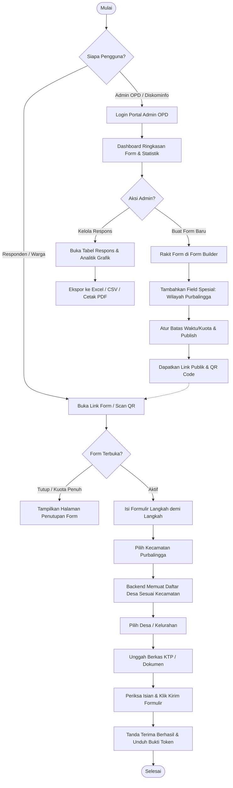
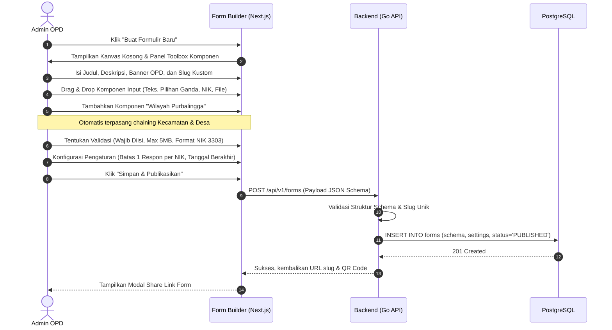
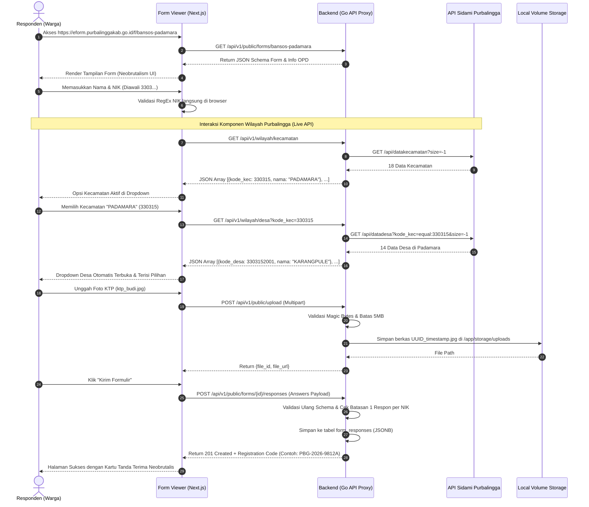
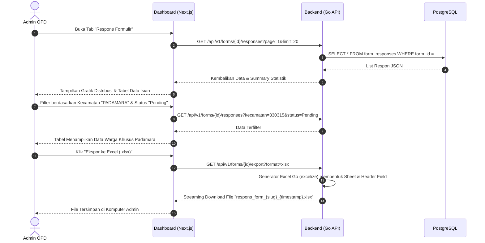

# Alur Aplikasi & Pengalaman Pengguna (App Flow & User Journey)

Dokumen ini memetakan seluruh alur kerja (workflow), diagram urutan interaksi pengguna (sequence flow), dan penanganan kasus khusus (*edge cases*) pada sistem **E-Form Kabupaten Purbalingga**.

---

## 1. Persona Pengguna & Matriks Hak Akses

| Persona | Peran & Lingkup | Hak Akses Utama |
| :--- | :--- | :--- |
| **Super Admin** *(Diskominfo Purbalingga)* | Pengelola master sistem seluruh kabupaten | - Manajemen akun OPD & Admin OPD - Monitoring lalu lintas & statistik server - Manajemen sinkronisasi API Wilayah Sidami - Audit trail seluruh aktivitas form |
| **Admin OPD** *(Dinas / Badan / Kecamatan)* | Pembuat dan pengelola form per dinas | - Membuat, mengedit, menduplikasi, dan mempublikasikan form - Mengonfigurasi komponen dinamis & aturan validasi - Mengatur jadwal buka/tutup form & kuota respon - Mengunduh data respon (Excel/CSV) & verifikasi berkas |
| **Verifikator OPD** *(Staf Pelayanan Dinas)* | Pemeriksa berkas masuk | - Membaca data respon formulir dinasnya - Mengubah status verifikasi (*Diterima / Ditolak / Revisi*) - Menambahkan catatan internal verifikasi |
| **Responden Publik** *(Warga Purbalingga / ASN)* | Pengisi formulir | - Mengakses form via link publik atau scan QR Code - Mengisi pertanyaan dinamis & memilih Kecamatan/Desa - Mengunggah foto KTP / berkas persyaratan - Menerima tanda terima digital / bukti submit |

---

## 2. Diagram Alur Makro Sistem (End-to-End System Journey)

---

## 3. Alur Detail: Form Builder (Admin OPD)

Admin OPD dapat merakit form secara visual ala Google Forms namun dengan fleksibilitas yang lebih kaya:

---

## 4. Alur Detail: Pengisian Formulir & Wilayah Chaining (Responden)

Alur interaksi responden saat mengisi form publik:

---

## 5. Alur Detail: Analitik & Ekspor Data (Admin OPD)

Admin dinas dapat memantau perolehan data secara langsung:

---

## 6. Skenario Khusus & Ketahanan Sistem (Edge Cases & Resilience)

### 6.1. Penanganan Akses API Sidami Purbalingga
- **Mekanisme:** Permintaan wilayah dari frontend diteruskan secara transparan melalui backend Go (`/api/v1/wilayah/*`) langsung ke API Sidami Purbalingga. Data wilayah tidak perlu disimpan ke database PostgreSQL, sehingga skema database tetap ringkas dan data wilayah selalu 100% mutakhir mengikuti server Sidami.
- **Error Handling:** Jika panggilan ke API Sidami gagal atau timeout, backend mengembalikan status HTTP 502/504 terstruktur dengan pesan ramah agar pengguna dapat mencoba kembali.

### 6.2. Warga Mengisi Form Panjang dengan Koneksi Tidak Stabil
- **Tantangan:** Koneksi smartphone warga putus saat mengisi survei panjang, menyebabkan data hilang saat halaman direfresh.
- **Solusi Frontend:** Formulir dilengkapi fitur **Autosave Local Draft** di browser (`localStorage`). Jika halaman tertutup atau tidak sengaja ter-refresh, sistem memunculkan banner pemberitahuan Neobrutalis: *"Ditemukan isian tersimpan sebelumnya. Pulihkan data?"*

### 6.3. Pencegahan Spam & Double Submit
- **Tantangan:** Pengguna menekan tombol "Kirim" berkali-kali secara cepat (*spam clicking*).
- **Solusi:**
  - Tombol submit otomatis memasuki status `disabled` dengan indikator spinner dan teks "Memproses...".
  - Frontend melampirkan *Idempotency-Key* (UUID per sesi form) di header permintaan. Backend menolak request kedua jika key yang sama sudah diproses dalam 60 detik terakhir.

### 6.4. Perlindungan Data Pribadi (UU PDP) untuk NIK & Berkas KTP
- Kolom NIK di database disimpan dengan hash terindeks untuk pencarian, sementara nilai aslinya dienkripsi simetris (AES-256-GCM) jika form menyaratkan kerahasiaan tinggi.
- URL unduhan berkas KTP tidak dapat diakses langsung oleh publik. Hanya admin yang memiliki token sesi aktif pada dinas terkait yang memiliki otoritas untuk melihat atau mengunduh dokumen.
