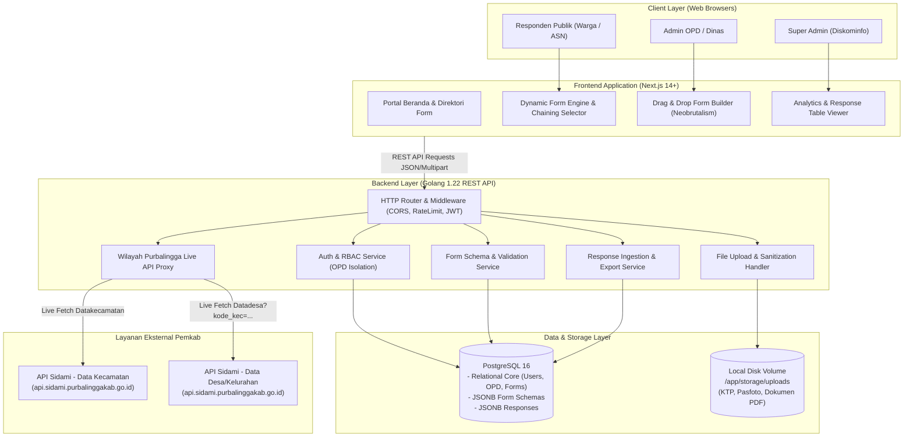
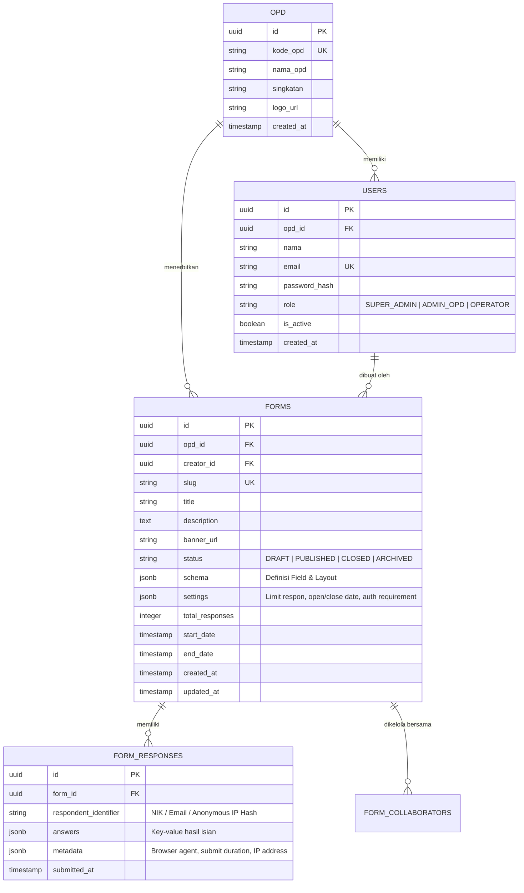
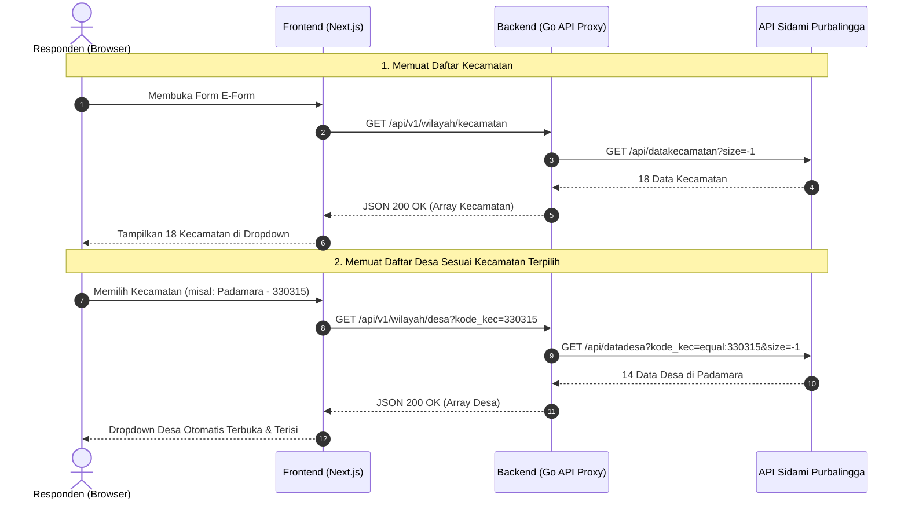
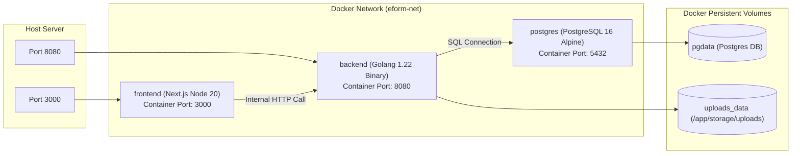

# Arsitektur Sistem: E-Form Kabupaten Purbalingga

Dokumen ini mendokumentasikan arsitektur sistem perangkat lunak, perancangan basis data, integrasi API wilayah Purbalingga, mekanisme penyimpanan berkas, dan orkestrasi container Docker untuk aplikasi **E-Form Kabupaten Purbalingga**.

---

## 1. Diagram Arsitektur Tingkat Tinggi (High-Level Architecture)



---

## 2. Rincian Lapisan Sistem (System Layers)

### 2.1. Lapisan Frontend (Next.js 14+ App Router)
- **Komponen Inti:**
  - `Form Builder Canvas`: Memungkinkan admin OPD merakit elemen form dengan drag-and-drop, mengubah label, placeholder, tipe validasi (required, min/max length, regex, file size limit), serta conditional logic.
  - `Form Renderer Engine`: Merender komponen form secara dinamis berdasarkan definisi schema JSON yang dikirim backend.
  - `Regional Chaining Component`: Dropdown bertingkat interaktif khusus Kabupaten Purbalingga. Pengguna memilih Kecamatan terlebih dahulu, lalu sistem secara reaktif memuat daftar Desa/Kelurahan yang sesuai dari API internal backend.
  - `Response Viewer & Exporter`: Menampilkan data isian dalam bentuk tabel interaktif neobrutalis, visualisasi diagram pie/batang untuk pertanyaan pilihan ganda, dan tombol ekspor XLSX/CSV.

### 2.2. Lapisan Backend (Golang Clean Architecture)
Aplikasi Go disusun dengan struktur modular berlapis:
```plaintext
HTTP Request -> Middleware -> Handler -> Service (Business Logic) -> Repository -> PostgreSQL
```
- **Ketahanan (Resilience):** Backend menangani request pengisian form dalam jumlah besar secara asinkronus dan efisien berkat goroutine Go.
- **Validasi Ganda (Dual Validation):** Selain validasi di sisi client, backend Go memvalidasi setiap field kiriman terhadap schema JSON yang tersimpan sebelum disimpan ke database.

### 2.3. Lapisan Basis Data (PostgreSQL 16)
Kombinasi model relasional untuk entitas kaku (User, OPD, Form metadata) dan `JSONB` untuk struktur yang fleksibel (Field Schema & Jawaban Responden).

---

## 3. Skema Basis Data (Database Schema & ERD)



### 3.1. Definisi Tabel Inti (SQL DDL)

```sql
-- Ekstensi UUID dan pencarian JSON
CREATE EXTENSION IF NOT EXISTS "uuid-ossp";
CREATE EXTENSION IF NOT EXISTS "pg_trgm";

-- 1. Tabel OPD
CREATE TABLE opd (
    id UUID PRIMARY KEY DEFAULT uuid_generate_v4(),
    kode_opd VARCHAR(50) UNIQUE NOT NULL,
    nama_opd VARCHAR(255) NOT NULL,
    singkatan VARCHAR(50),
    logo_url VARCHAR(500),
    created_at TIMESTAMP WITH TIME ZONE DEFAULT NOW(),
    updated_at TIMESTAMP WITH TIME ZONE DEFAULT NOW()
);

-- 2. Tabel Pengguna (Admin)
CREATE TABLE users (
    id UUID PRIMARY KEY DEFAULT uuid_generate_v4(),
    opd_id UUID REFERENCES opd(id) ON DELETE SET NULL,
    nama VARCHAR(150) NOT NULL,
    email VARCHAR(150) UNIQUE NOT NULL,
    password_hash VARCHAR(255) NOT NULL,
    role VARCHAR(50) NOT NULL DEFAULT 'ADMIN_OPD', -- SUPER_ADMIN, ADMIN_OPD, OPERATOR
    is_active BOOLEAN DEFAULT TRUE,
    created_at TIMESTAMP WITH TIME ZONE DEFAULT NOW(),
    updated_at TIMESTAMP WITH TIME ZONE DEFAULT NOW()
);

-- 3. Tabel Formulir
CREATE TABLE forms (
    id UUID PRIMARY KEY DEFAULT uuid_generate_v4(),
    opd_id UUID NOT NULL REFERENCES opd(id) ON DELETE CASCADE,
    creator_id UUID NOT NULL REFERENCES users(id) ON DELETE RESTRICT,
    slug VARCHAR(150) UNIQUE NOT NULL,
    title VARCHAR(255) NOT NULL,
    description TEXT,
    banner_url VARCHAR(500),
    status VARCHAR(50) NOT NULL DEFAULT 'DRAFT', -- DRAFT, PUBLISHED, CLOSED, ARCHIVED
    schema JSONB NOT NULL DEFAULT '{"fields": []}',
    settings JSONB NOT NULL DEFAULT '{
        "is_public": true,
        "require_nik": false,
        "one_response_per_nik": false,
        "max_submissions": 0,
        "allow_edit_response": false,
        "send_email_receipt": false
    }',
    total_responses INTEGER NOT NULL DEFAULT 0,
    start_date TIMESTAMP WITH TIME ZONE,
    end_date TIMESTAMP WITH TIME ZONE,
    created_at TIMESTAMP WITH TIME ZONE DEFAULT NOW(),
    updated_at TIMESTAMP WITH TIME ZONE DEFAULT NOW()
);

CREATE INDEX idx_forms_slug ON forms(slug);
CREATE INDEX idx_forms_opd_id ON forms(opd_id);
CREATE INDEX idx_forms_status ON forms(status);
CREATE INDEX idx_forms_schema ON forms USING gin (schema);

-- 4. Tabel Respons Formulir
CREATE TABLE form_responses (
    id UUID PRIMARY KEY DEFAULT uuid_generate_v4(),
    form_id UUID NOT NULL REFERENCES forms(id) ON DELETE CASCADE,
    respondent_identifier VARCHAR(255), -- NIK terenkripsi / Token anonim
    answers JSONB NOT NULL,
    metadata JSONB DEFAULT '{}',
    submitted_at TIMESTAMP WITH TIME ZONE DEFAULT NOW()
);

CREATE INDEX idx_responses_form_id ON form_responses(form_id);
CREATE INDEX idx_responses_submitted_at ON form_responses(submitted_at DESC);
CREATE INDEX idx_responses_answers ON form_responses USING gin (answers);
```

---

## 4. Spesifikasi Schema JSON Dynamic Form

Field pada form disimpan di kolom `forms.schema` dalam format JSON standar berikut:

```json
{
  "version": "1.0",
  "theme": {
    "accentColor": "#FFE600",
    "headerBanner": "/uploads/banners/purbalingga-banner.jpg"
  },
  "sections": [
    {
      "id": "sec_1",
      "title": "Data Identitas Pemohon",
      "description": "Silakan isi data diri sesuai KTP Purbalingga Anda.",
      "fields": [
        {
          "id": "field_nik",
          "type": "nik",
          "label": "Nomor Induk Kependudukan (NIK)",
          "placeholder": "3303xxxxxxxxxxxx",
          "helpText": "Wajib 16 digit angka KTP Purbalingga (diawali 3303)",
          "required": true,
          "validation": {
            "pattern": "^3303[0-9]{12}$",
            "minLength": 16,
            "maxLength": 16
          }
        },
        {
          "id": "field_nama",
          "type": "text",
          "label": "Nama Lengkap",
          "placeholder": "Contoh: Budi Santoso",
          "required": true
        },
        {
          "id": "field_wilayah_purbalingga",
          "type": "regional_purbalingga",
          "label": "Domisili di Kabupaten Purbalingga",
          "helpText": "Pilih kecamatan dan desa sesuai tempat tinggal",
          "required": true,
          "config": {
            "kecamatanFieldId": "field_kecamatan",
            "desaFieldId": "field_desa",
            "showKodePos": false
          }
        },
        {
          "id": "field_berkas_ktp",
          "type": "file_upload",
          "label": "Upload Foto KTP / KK",
          "helpText": "Format JPG, PNG, atau PDF. Maksimal 5 MB.",
          "required": true,
          "validation": {
            "allowedExtensions": ["jpg", "jpeg", "png", "pdf"],
            "maxSizeInMB": 5
          }
        }
      ]
    }
  ]
}
```

### Matriks Tipe Input yang Didukung:
1. `text`: Input teks baris tunggal.
2. `textarea`: Paragraf panjang / deskripsi.
3. `number`: Angka numerik murni.
4. `currency_idr`: Format mata uang Rupiah otomatis.
5. `radio`: Pilihan ganda (hanya satu pilihan).
6. `checkbox`: Pilihan ganda (bisa lebih dari satu pilihan).
7. `select`: Dropdown standar.
8. `date` / `time` / `datetime`: Pemilih tanggal dan jam.
9. `file_upload`: Unggah berkas dokumen/gambar dengan batas MIME & ukuran.
10. `regional_purbalingga`: **Spesial Input Chaining** (Kecamatan -> Desa Purbalingga via Sidami).
11. `nik`: Input khusus 16 digit NIK dengan validasi prefiks `3303`.
12. `signature`: Tanda tangan digital langsung di layar sentuh / canvas.
13. `rating` / `linear_scale`: Penilaian skala 1-5 atau 1-10 (misal: Survei Kepuasan Masyarakat / SKM).

---

## 5. Arsitektur Integrasi Live API Wilayah Sidami

Data wilayah Kecamatan & Desa Purbalingga sepenuhnya diambil secara *live* dari API Sidami (tanpa disimpan di database):



---

## 6. Arsitektur File Upload & Local Volume Storage

Berkas disimpan secara aman di direktori lokal server yang dihubungkan melalui Docker Volume.

### 6.1. Struktur Folder Storage
```plaintext
/app/storage/uploads/
├── forms/                  # Cover banner & logo form
│   └── 2026/10/
├── submissions/            # Berkas respon warga (KTP, Dokumen)
│   └── {form_id}/
│       └── 2026/10/
└── temp/                   # Penampungan sementara sebelum divalidasi
```

### 6.2. Aturan Keamanan File Upload
1. **Pencegahan Path Traversal:**
   ```go
   cleanFileName := filepath.Base(fileHeader.Filename)
   safeName := fmt.Sprintf("%s_%d%s", uuid.New().String(), time.Now().Unix(), filepath.Ext(cleanFileName))
   finalPath := filepath.Join(uploadDir, safeName)
   ```
2. **Validasi Magic Bytes (MIME Sniffing):**
   Tidak mempercayai ekstensi yang dikirim client. Backend membaca 512 byte pertama file (`http.DetectContentType`) untuk memastikan file benar-benar gambar JPEG/PNG atau dokumen PDF asli, bukan script berbahaya (`.php`, `.sh`, `.exe`).
3. **Penyajian Berkas (File Serving):**
   Berkas respon hanya bisa diunduh oleh Admin OPD terkait melalui authenticated URL token (`/api/v1/submissions/files/{token}`), tidak dibuka sembarangan ke publik untuk menjaga privasi data kependudukan.

---

## 7. Orkestrasi Docker Compose

Topologi Docker Compose terdiri dari 3 service utama yang saling terhubung dalam jaringan internal tertutup:



Spesifikasi konfigurasi `docker-compose.yml` telah dipersiapkan dengan restart policy `unless-stopped`, environment variables terisolasi, dan volume disk persisten untuk mencegah kehilangan data.
